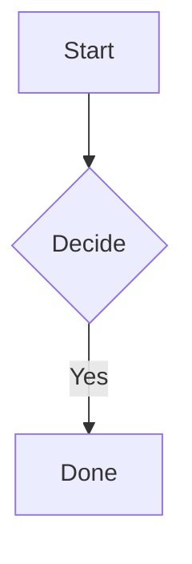

# GitHub extras

> [!NOTE]
> Useful information.

> [!TIP]
> Helpful advice.

> [!IMPORTANT]
> Key information.

> [!WARNING]
> Urgent info.

> [!CAUTION]
> Risky action.

Done :white_check_mark: · Bug :bug: · Unknown :not_a_shortcode:

Inline math $e^{i\pi} + 1 = 0$ and prices $5 and $10 stay text.

$$
\sum_{n=1}^{\infty} \frac{1}{n^2} = \frac{\pi^2}{6}
$$

Details

Hidden by default on GitHub, open here.

